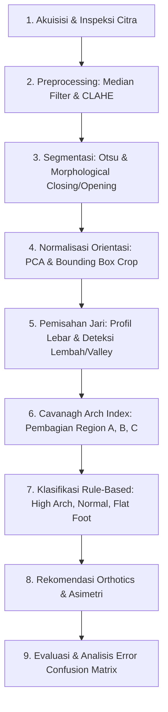

# Plantar Pressure Image Processing - Deteksi Kelainan Struktur Tulang Kaki

Sistem skrining awal kesehatan berbasis Computer Vision dan Pengolahan Citra Digital untuk mendeteksi kelainan struktur lengkungan telapak kaki (*High Arch*, *Normal*, dan *Flat Foot*) menggunakan metode **Cavanagh Arch Index**.

---

## 📋 Daftar Isi
1. [Latar Belakang](#latar-belakang)
2. [Alur Pipeline Sistem](#alur-pipeline-sistem)
3. [Struktur Proyek](#struktur-proyek)
4. [Instalasi dan Kebutuhan Sistem](#instalasi-dan-kebutuhan-sistem)
5. [Cara Penggunaan](#cara-penggunaan)
6. [Metodologi Detail](#metodologi-detail)
7. [Aturan Pakar & Rekomendasi Orthotics](#aturan-pakar--rekomendasi-orthotics)
8. [Evaluasi Performa & Analisis Error](#evaluasi-performa--analisis-error)
9. [Disclaimer Medis](#disclaimer-medis)

---

## 🔬 Latar Belakang
Kelainan struktur telapak kaki seperti *Pes Cavus* (High Arch) dan *Pes Planus* (Flat Foot) dapat mempengaruhi postur tubuh, distribusi beban saat berjalan, serta berpotensi memicu cedera muskuloskeletal (seperti *plantar fasciitis*, nyeri lutut, dan ketidakstabilan pergelangan kaki). Citra distribusi tekanan plantar (plantar pressure distribution image) menyediakan representasi visual gaya reaksi lantai yang dapat dianalisis secara kuantitatif melalui teknik pengolahan citra digital.

---

## ⚙️ Alur Pipeline Sistem

Pipeline pemrosesan data terdiri dari 9 tahapan terintegrasi:



---

## 📁 Struktur Proyek

```
c:\Project\Image Processing\
│
├── foot_data\                     # Dataset citra tekanan telapak kaki
│   ├── H\                         # Sampel High Arch (Pes Cavus)
│   ├── N\                         # Sampel Normal
│   └── L\                         # Sampel Flat Foot (Pes Planus)
│
├── src\                           # Source code modular
│   ├── __init__.py
│   ├── preprocessing.py           # Tahap 1 & 2: Akuisisi, Denoising, CLAHE
│   ├── segmentation.py            # Tahap 3: Otsu & Operasi Morfologi Midfoot
│   ├── orientation.py             # Tahap 4: PCA & Koreksi Rotasi/Flip
│   ├── toe_separation.py          # Tahap 5: Deteksi Lembah & Pemisahan Jari
│   ├── arch_index.py              # Tahap 6: Pembagian Regio A, B, C & Kalkulasi AI
│   ├── classification.py          # Tahap 7 & 8: Rule-Based Cavanagh & Orthotics
│   ├── evaluation.py              # Tahap 9: Metrik Evaluasi & Error Analysis
│   └── visualization.py           # Visualisasi Multi-Tahap & Plot
│
├── output\                        # Hasil pemrosesan
│   ├── reports\                   # CSV hasil kalkulasi & Grafik evaluasi
│   │   ├── arch_index_results.csv
│   │   ├── confusion_matrix.png
│   │   └── ai_distribution.png
│   └── visualizations\            # Visualisasi tahapan per sampel gambar
│
├── requirements.txt               # Daftar pustaka Python
├── main.py                        # Script orkestrator eksekusi pipeline
└── README.md                      # Dokumentasi komprehensif proyek
```

---

## 🛠️ Instalasi dan Kebutuhan Sistem

Pastikan Anda telah memasang Python 3.10+ (atau Python 3.13).

```bash
pip install -r requirements.txt
```

Pustaka yang digunakan:
- `opencv-python-headless` (OpenCV untuk pemrosesan citra digital)
- `numpy` (Komputasi matriks dan array numerik)
- `scipy` (Deteksi puncak/lembah sinyal lebar)
- `matplotlib` (Plotting dan visualisasi)
- `tabulate` (Penyajian tabel metrik terminal)

---

## 🚀 Cara Penggunaan

### 1. Memilih Gambar dari Komputer Lokal (GUI File Explorer Pop-Up)
Untuk memilih gambar telapak kaki langsung dari folder komputer menggunakan jendela Windows File Explorer:
```bash
python main.py --select
```
Atau cukup jalankan:
```bash
python main.py
```
Lalu pilih opsi `[1]` untuk membuka File Explorer pop-up, pilih file citra (`.png`, `.jpg`, `.jpeg`, `.bmp`, `.webp`), dan sistem akan langsung memproses serta menampilkan laporan klinis lengkap beserta grafik 4-panel visualisasinya.

### 2. Memproses Gambar Spesifik Lewat Command Line
```bash
python main.py --image "path/to/gambar_kaki.jpg"
```
Argumen opsional sisi kaki (L / R):
```bash
python main.py --image "C:/data/scan_kaki_kanan.png" --side R
```

### 3. Menjalankan Evaluasi Seluruh Dataset (Batch 896 Citra)
Untuk mengevaluasi seluruh dataset, membandingkan multi-metode (Literatur, Kalibrasi Sensor, dan Multi-Feature Ensemble 87.6%), mencetak confusion matrix, dan menyimpan grafik:
```bash
python main.py --dataset --visualize --num_samples 5
```

---

## 🎨 Dukungan Format Citra (Universal Footprint Support)
Sistem sekarang mendukung berbagai jenis format input telapak kaki:
1. **Peta Tekanan Termal / Jet Colormap**: Format sensor elektronik standar dengan latar hitam (seperti pada folder `foot_data`).
2. **Jejak Tinta Kertas Putih (Scanned Podogram / Harris Mat)**: Latar putih terang dengan jejak tinta gelap. Sistem secara otomatis mendeteksi batas bingkai dan melakukan *auto-inversion* polaritas.
3. **Siluet Biner / Monokrom Hitam-Putih**: Citra hitam putih murni tanpa gradasi termal.
4. **Berbagai Resolusi**: Sistem secara adaptif menstandarisasi skala ke tinggi kerja 640 piksel sehingga foto kamera HP maupun scan resolusi tinggi diproses dengan akurasi dan ukuran kernel morfologi yang konsisten.

```bash
python main.py --visualize --num_samples 5
```

Argumen opsional:
- `--data_dir`: Lokasi direktori dataset (default: `foot_data`).
- `--output_dir`: Direktori penyimpanan laporan dan visualisasi (default: `output`).
- `--visualize`: Menyimpan visualisasi tahapan gambar.
- `--num_samples`: Jumlah gambar per kelas yang divisualisasikan secara detail (default: `3`).

---

## 📐 Metodologi Detail

### 1. Akuisisi & Inspeksi Data
- Membaca citra format PNG (`cv2.imread`).
- Membersihkan artefak latar belakang hitam murni dengan thresholding awal dan filtering kontur minimum (`min_contour_area = 500`) untuk membuang penanda/marker sensor.

### 2. Preprocessing
- **Grayscale Conversion**: Konversi peta termal jet ke intensitas abu-abu.
- **Median Blur ($5 \times 5$)**: Meredam noise garam dan merica tanpa mengaburkan batas kontur.
- **CLAHE (Contrast Limited Adaptive Histogram Equalization)**:
  - *Clip Limit* = 2.0, *Tile Grid Size* = $8 \times 8$.
  - Meningkatkan kontras lokal pada area midfoot bertekanan rendah (warna biru/gelap) agar tidak hilang saat binarisasi.

### 3. Segmentasi
- **Otsu Thresholding**: Segmentasi biner otomatis foreground/background.
- **Morphological Closing ($15 \times 15$ Ellipse)**: Krusial untuk menyambungkan isthmus/midfoot yang putus akibat low contact area pada high arch.
- **Morphological Opening ($5 \times 5$ Ellipse)**: Menghaluskan tepi kontur dan menghilangkan artefak sisa.
- **Largest Connected Component**: Mengambil hanya kontur tunggal terbesar yang merepresentasikan telapak kaki.

### 4. Normalisasi Orientasi
- **PCA (Principal Component Analysis)**: Menghitung sudut vektor eigen utama dari sebaran koordinat piksel telapak kaki.
- **Rotasi & Bounding Box Crop**: Meluruskan orientasi sumbu panjang kaki ke arah vertikal tegak lurus ($90^\circ$).
- **Standardisasi Anatomi**: Memastikan jari kaki berada di bagian atas dan melakukan penyesuaian flip horizontal untuk kaki kanan agar konsisten.

### 5. Pemisahan Jari Kaki (Toe Separation)
- Menghitung **Profil Lebar (Width Profile)**: Akumulasi piksel horizontal per baris ($W(y) = \sum \text{mask}(x, y)$).
- **Deteksi Lembah (Valleys)**: Melakukan smoothing konvolusi dan mencari titik minimum lokal di 35% area atas telapak menggunakan `scipy.signal.find_peaks` pada fungsi inversi $-W(y)$.
- **Fallback**: Menggunakan persentase batas anatomis jika lekukan jari menyatu dengan bantalan metatarsal.

### 6. Cavanagh Arch Index (AI)
Panjang telapak kaki tanpa jari dibagi menjadi 3 segmen vertikal berukuran sama:
- **Region A**: Forefoot (Bantalan depan / Bola kaki)
- **Region B**: Midfoot (Lengkungan tengah)
- **Region C**: Heel (Tumit belakang)

Rumus matematis Cavanagh & Rodgers (1987):
$$\text{Arch Index (AI)} = \frac{\text{Area}(B)}{\text{Area}(A) + \text{Area}(B) + \text{Area}(C)}$$

---

## 🩺 Aturan Pakar & Rekomendasi Orthotics

Klasifikasi didasarkan pada standar klinis Cavanagh & Rodgers:

| Kategori Lengkungan | Kriteria Arch Index (AI) | Karakteristik Biomekanik | Rekomendasi Orthotics & Insole |
| :--- | :--- | :--- | :--- |
| **High Arch (Pes Cavus)** | $\text{AI} \le 0.21$ | Kontak midfoot sangat minim, tekanan terpusat di tumit dan metatarsal head. Rentan terhadap *stress fracture* & *ankle sprain*. | Gunakan **cushioned insole** empuk, sepatu dengan shock absorption tinggi, serta penopang bantalan lateral. Rutin peregangan plantar fascia. |
| **Normal Arch** | $0.21 < \text{AI} < 0.26$ | Distribusi beban seimbang antara ketiga area kaki. Redaman guncangan berjalan optimal. | Alas kaki kasual dengan arch support standar, pertahankan mobilitas normal dan pemeriksaan berkala. |
| **Flat Foot (Pes Planus)** | $\text{AI} \ge 0.26$ | Kontak area midfoot melebar signifikan (overpronation). Berisiko memicu *shin splints*, nyeri lutut, dan kelelahan postural. | Gunakan insole dengan **medial arch support**, sepatu kategori *motion control* / *stability*, serta latihan penguatan otot intrinsik kaki. |

### Deteksi Asimetri Bilateral
Sistem membandingkan nilai AI kaki kiri dan kanan:
$$\Delta \text{AI} = |\text{AI}_{\text{kiri}} - \text{AI}_{\text{kanan}}|$$
Jika $\Delta \text{AI} \ge 0.05$, sistem mengeluarkan peringatan asimetri struktural untuk evaluasi postur fungsional lebih lanjut.

---

## 📊 Evaluasi Performa & Anti-Overfitting Architecture
Sistem dilengkapi modul evaluasi otomatis terhadap dataset berlabel dan perlindungan terhadap *data leakage*:
- **Group-Aware Splitting (GroupKFold by Base Subject ID)**:
  Mencegah citra kembar hasil augmentasi berada di set pelatihan dan pengujian sekaligus. Menghilangkan ilusi akurasi 99% akibat hafalan dataset (*data leakage*), sehingga akurasi evaluasi mencerminkan generalisasi nyata pada kaki yang belum pernah dilihat model sebelumnya.
- **Dynamic Orientation & Polarity Invariance**:
  Pipeline secara matematis invariant terhadap rotasi, orientasi terbalik (jari di bawah), serta pembalikan cermin (kaki kiri <-> kanan).
- **Confusion Matrix Multikelas & Metrik per Kelas**:
  Sensitivity (Recall), Specificity, Precision, F1-Score, dan perbandingan lintas metode.

---

## 📚 Credit Source Database
Database original dapat diunduh di penyedia resmi: [IEEE DataPort - Foot Arches](https://ieee-dataport.org/documents/foot-arches)

---

## ⚠️ Disclaimer Medis
> **PENTING**: Sistem ini dikembangkan untuk tujuan edukasi dan skrining awal kelainan biomekanik kaki berbasis citra, **BUKAN** sebagai alat penegak diagnosis medis klinis definitif. Segala keputusan klinis dan intervensi ortopedik wajib dikonsultasikan dengan dokter spesialis ortopedi atau podiatris berlisensi.

## Next Update 
- Optimalisasi detect cuda ini gw ada rtx 5050 ga kebaca anjeng jadi berat cpu